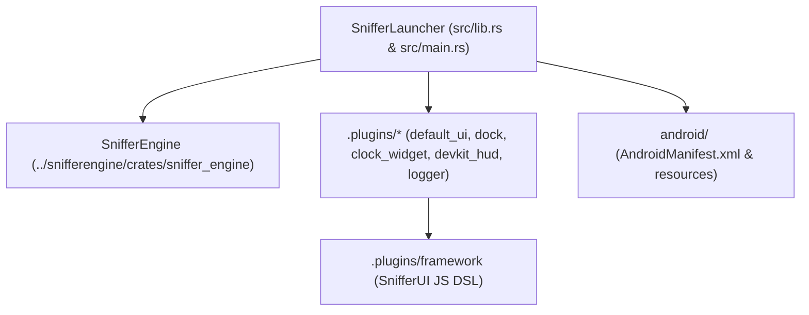

# SnifferLauncher

> A fast, native Android launcher built in Rust on top of [SnifferEngine](https://github.com/GreenKod/snifferengine), with a declarative JavaScript plugin UI (`SnifferUI`) and an experimental desktop simulator.

[](https://github.com/GreenKod/snifferlauncher/actions/workflows/check.yml)
[](https://www.rust-lang.org/)
[](#requirements)
[](LICENSE)

SnifferLauncher is a pure host application and plugin suite built on top of **SnifferEngine**. It gives you a launcher runtime you can inspect, extend, and iterate on without a JVM or a full Android Gradle build stack.

**No Java. No Kotlin. No Gradle. Just Rust, SnifferEngine, and a plugin-oriented UI runtime.**

---

## Architecture

SnifferLauncher is cleanly decoupled from the underlying UI/physics/rendering engine (`snifferengine`):



### Repository Layout

```text
sniffers/
├── snifferengine/     # Standalone 120Hz UI, Physics & Graphics Engine repository
└── snifferlauncher/   # This repository (Android/Desktop Launcher host & plugins)
    ├── .plugins/      # Launcher UI plugins (default_ui, dock, clock_widget, devkit_hud, logger)
    ├── android/       # AndroidManifest.xml and launcher icons/resources
    ├── scripts/       # Desktop, Android, and pre-flight quality scripts
    ├── src/           # Thin host entry points (lib.rs for Android, main.rs for Desktop)
    └── tests/         # Launcher-specific UI, spring cascade, and manifest tests
```

---

## Quick Start

Clone both `snifferengine` and `snifferlauncher` side by side inside a parent folder (e.g. `sniffers/`):

```bash
mkdir sniffers && cd sniffers
git clone https://github.com/GreenKod/snifferengine.git
git clone https://github.com/GreenKod/snifferlauncher.git
cd snifferlauncher
```

### Desktop Simulator

Run the simulator with the default feature set:

```bash
cargo run --bin snifferlauncher-desktop
```

Enable the optional diagnostics HUD with the `devkit` feature:

```bash
cargo run --bin snifferlauncher-desktop --features devkit
```

For a release build:

```bash
cargo run --bin snifferlauncher-desktop --release
```

### Android

With a connected device and USB debugging enabled:

```bash
cargo apk run --target aarch64-linux-android --lib --release
```

For an x86_64 emulator:

```bash
cargo apk run --target x86_64-linux-android --lib --release --features devkit
```

---

## Plugin Development

Launcher plugins live in [`.plugins/`](.plugins) and are powered by the [`SnifferUI`](.plugins/framework) declarative JavaScript framework. Every script file loaded by a plugin is verified against its SHA-256 digest declared in `manifest.json`.

---

## Development Checks

Run the local pre-flight quality gate script:

```bash
./scripts/check.sh
```

Or run the individual checks manually:

```bash
cargo fmt --all --check
cargo check --locked --workspace
cargo clippy --locked --workspace --all-targets -- -D warnings
cargo test --locked --workspace --all-features
```

---

## License

SnifferLauncher is distributed under the [Apache License 2.0](LICENSE).
